

<h1 align="center">Mappex, Gerador de Leads</h1>

B2B lead-generation SaaS with a built-in WhatsApp CRM.

  <kbd> React</kbd> <kbd> TypeScript</kbd> <kbd> Tailwind CSS</kbd> <kbd> Vite</kbd> <kbd> NestJS</kbd> <kbd> Fastify</kbd> <kbd> Drizzle ORM</kbd> <kbd> PostgreSQL</kbd> <kbd> Leaflet</kbd> <kbd> Docker</kbd> <kbd> Nginx</kbd> <kbd> Cloudflare</kbd>

 &nbsp; 

> The source code is private; this repository presents the project. Demo: [gerador-de-leads.alcetus.com](http://gerador-de-leads.alcetus.com).

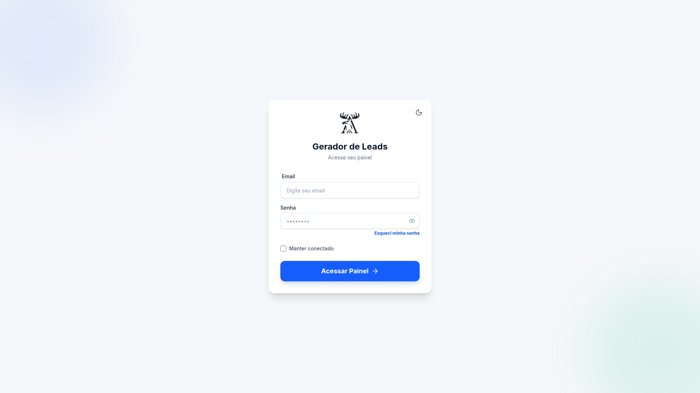

<table>
<tr>
<td align="center" width="25%"><b>28</b> database tables</td><td align="center" width="25%"><b>8+</b> external integrations</td><td align="center" width="25%"><b>3,768</b> passing tests</td><td align="center" width="25%"><b>Supabase</b> rewritten for NestJS</td>
</tr>
</table>

### Overview

Mappex is a B2B lead generation platform with a built-in CRM and WhatsApp messaging. The user types a niche (for example "dental clinic") and a city, and the system returns real businesses with phone, address, rating and map position. Those contacts go into the user's own database, get checked for WhatsApp, and move on to a Kanban CRM where they become conversations, campaigns or automations.

It is built for people who prospect local businesses: agencies, consultants, small sales teams. The problem it solves is the gap between finding a contact and talking to them. That usually means a spreadsheet, a scraping tool, a chat app and a manually kept funnel. Here it all runs in one place, with one record and one history.

The code is private. This README describes what the product does and how it was built.

### How it works

1. The user signs in with email and password or a Google account.
2. They enter a niche and a city and start a search. Each account runs one search at a time.
3. The system gets the city's real neighborhoods from OpenStreetMap and asks the AI to pick the most commercial ones for that niche.
4. Each neighborhood becomes a Serper query, which returns Google Maps businesses. Repeated leads are dropped.
5. Leads show up on the dashboard and map. In the background, phones are normalized, the state is extracted from the address and the number is checked for WhatsApp.
6. The user sends leads to a CRM, connects a WhatsApp number and follows conversations on the Kanban board.
7. Campaigns and automations handle sending at scale, inside time windows and hourly and daily caps.

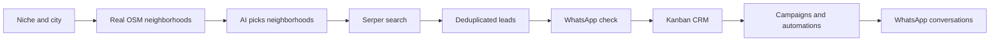

### Features in detail

#### Lead generation

The screen takes a niche and region and follows the search progress. Behind it, the request becomes a job in a pg-boss queue, which runs inside PostgreSQL itself, with no Redis.

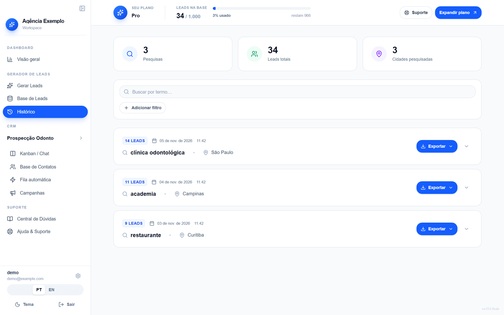 Search history, with totals for searches, leads and cities, and an export button on each search.

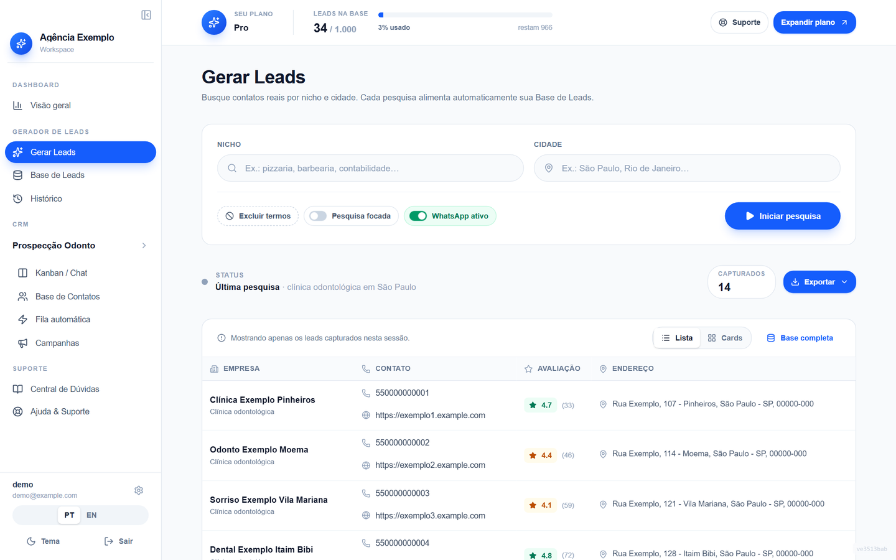 Generate Leads screen: niche, city and search options, with the captured leads right below.

- A partial unique index in the database, a pre-check and the job key keep each user to one active search.
- Deduplication is per business, using the Serper place identifier, with phone and name as fallbacks.
- A cron collects stuck searches and records an error code, which the front end translates to PT or EN.
- Per-plan lead caps and a rolling 3-hour window come from configuration.

#### Neighborhoods and AI

Neighborhoods come from OpenStreetMap (Nominatim and Overpass) and are cached permanently per city. The AI, a Llama 3.3 model on Groq, only chooses from that list. Any name outside it is discarded.

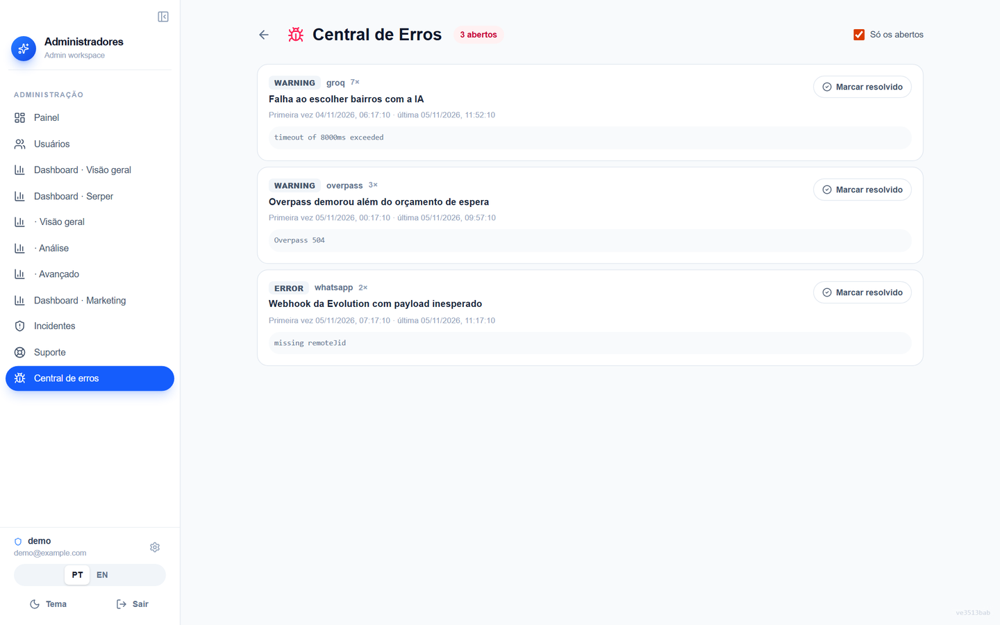 Error center: AI and Overpass failures show up grouped, with an occurrence count.

- If Overpass is slow, the search moves on without waiting and a background attempt fills the cache for the next one.
- If Groq fails, the search uses the real neighborhoods without curation, or the whole city.
- The failure becomes a Discord alert, at most one per hour, plus a grouped row in the error center.

#### Dashboard and map

The dashboard is made of widgets with a per-user saved layout, and the map uses Leaflet.

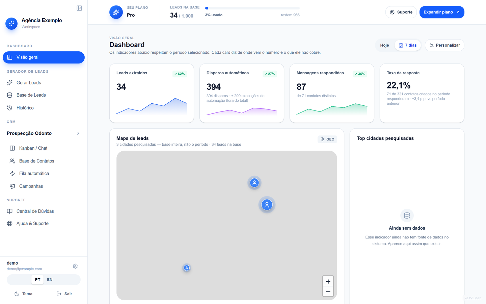 Dashboard with period KPIs, sparklines and the lead map by searched city (Leaflet). Map shown without background tiles.

- One endpoint returns one block per widget, and all hooks share that request.
- The backend sends codes, never sentences. The UI translates.
- Where there is no data source, the widget shows an unavailable state instead of an invented number.

#### Kanban CRM

Each user can have several CRM views, each with its own columns, contacts, tags and WhatsApp numbers. The Kanban uses dnd-kit.

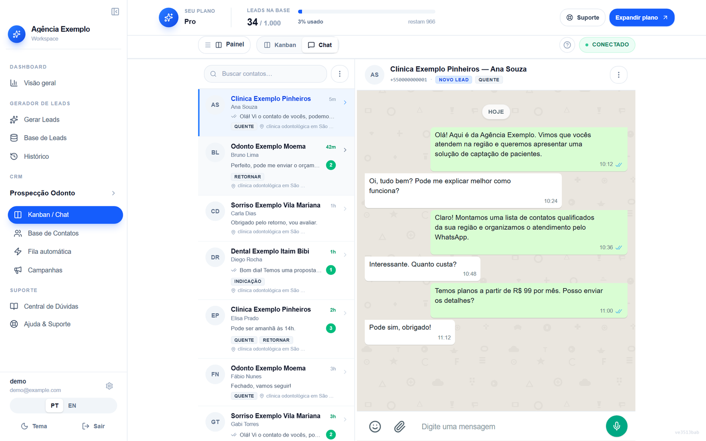 Chat built into the CRM: conversation list and message window side by side.

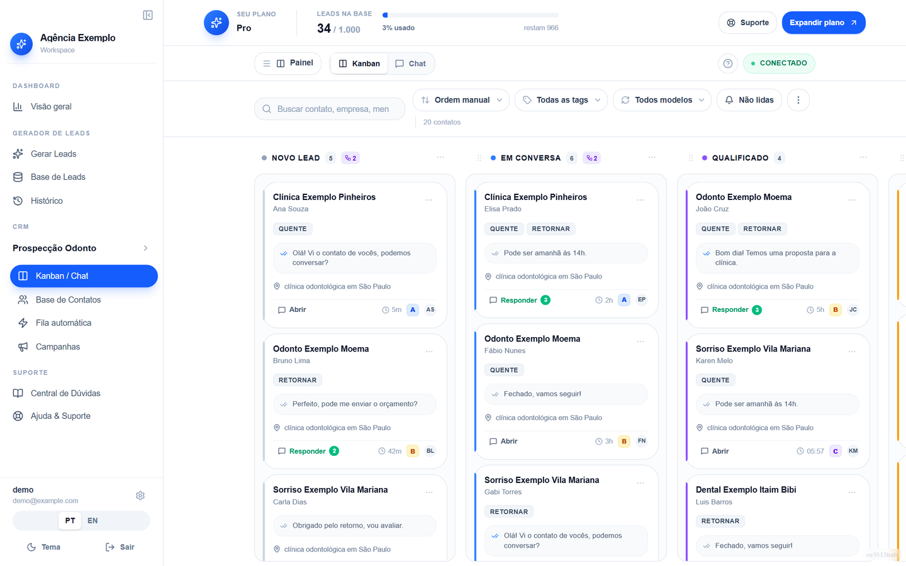 CRM Kanban with columns, tags, template used and unread counts on each card.

- Contacts come from lead import, manual entry and webhook.
- Built-in chat with media and real-time updates over SSE.
- Outgoing webhook and email invites.

#### WhatsApp

There are two channels: Evolution API (unofficial) and Meta Cloud API (official).

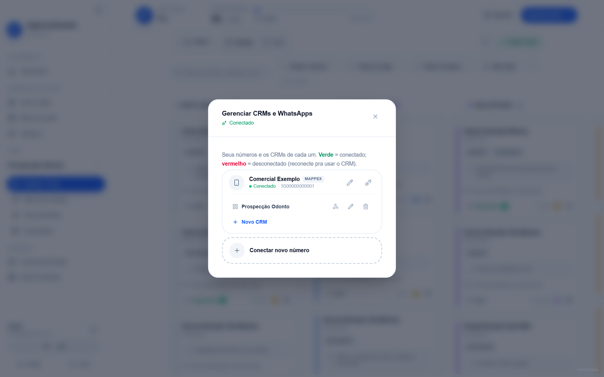 Management of WhatsApp numbers and the CRMs linked to each one.

- Inbound events feed the history and move contacts.
- Opt-out keywords stop sending to that contact.
- Brazilian phone numbers are canonicalized, including the ninth digit, to match the verification.

#### Campaigns and auto-send

The wizard asks for the channel up front, because it decides the rest of the flow. On the Mappex channel the message is free text with `@` variables. On the official channel the text becomes a Meta-approved template, and `@name` is compiled to a positional variable.

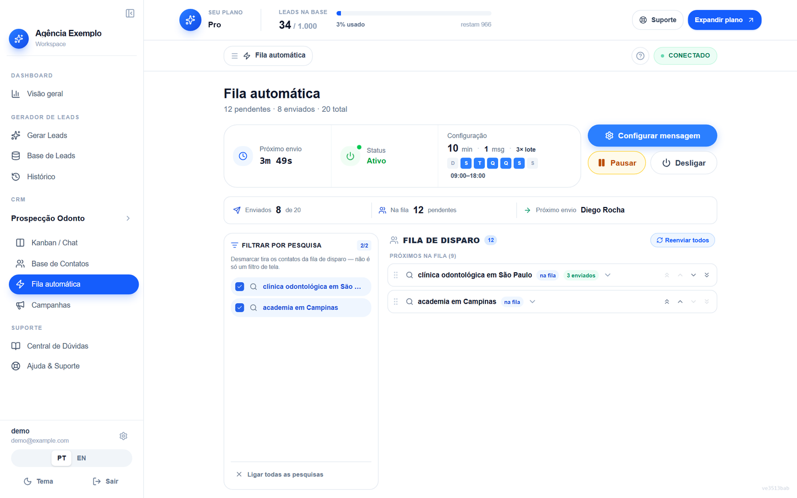 Auto-send queue: next send, time window, pace, per-search queue and sent count.

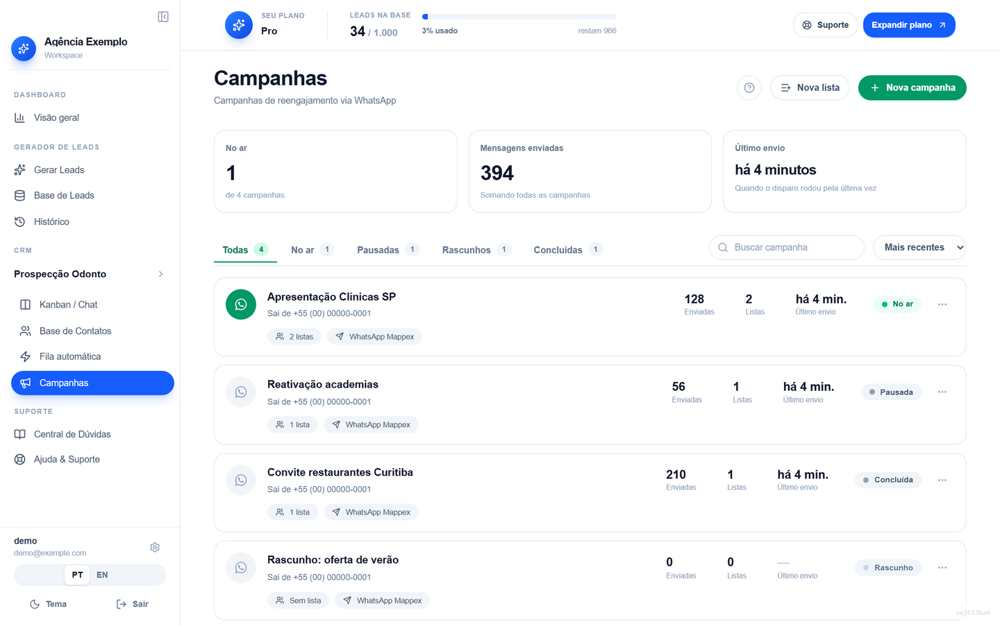 Campaign list with status, sent count, lists and last dispatch.

- Pace set by the user, capped at 100 per hour and 1,000 per day.
- Rotation of 2 to 3 messages.
- Sending runs on the server, by cron, with a claim recorded before each action.

#### Automations

Per-column rules, run on the server with no browser open. Triggers: enter a column, time in column, reply received, keyword and time without reply. Actions: send a message, move, or both. A plain move skips the time windows.

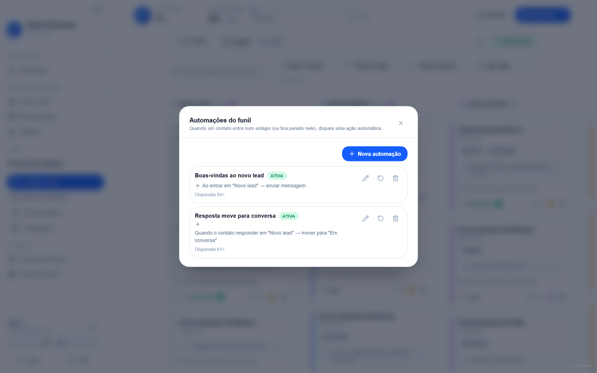 Funnel automations: per-column rules with trigger, action and how many times each fired.

#### Administration

User management, audited impersonation, metrics, an error center, support messages, security incidents with a notification deadline computed at read time, account deletion with a reminder, and remarketing emails based on quota usage.

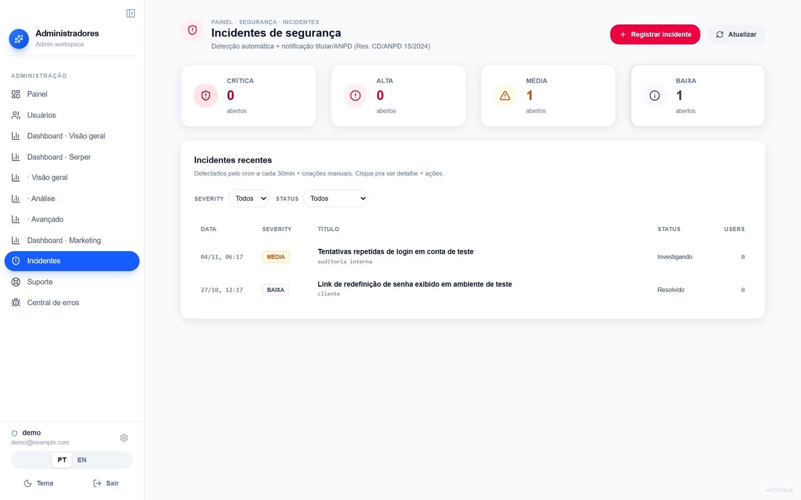 Security incidents with severity, status and count per level.

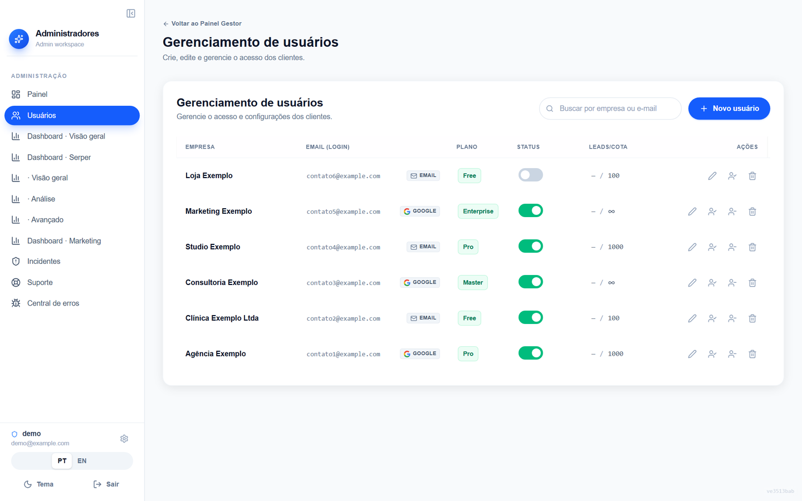 User management: plan, status, lead quota and actions such as impersonation.

### Architecture

The front end is a React 19 SPA with TypeScript, Vite, Tailwind and i18next (PT and EN). The backend is NestJS on Fastify, with Drizzle ORM and PostgreSQL. The queue and the crons run in the same process.

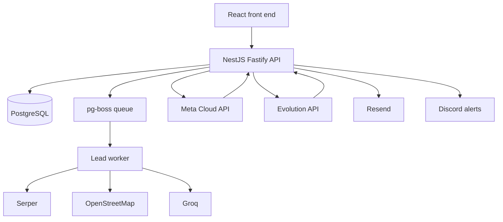

Data model, 28 tables. Summary:

- **Account:** users, login identities (email or Google), sessions, plan subscriptions, audit trail.
- **Leads:** searches, leads (one per business, tied to the search and the user), Serper cache and usage, neighborhoods per city.
- **CRM:** views, columns, contacts, messages, tags, WhatsApp instances, phone verifications, events.
- **Sending:** campaigns and their sends, auto-send, automations with an execution log.
- **Operations:** dashboard layouts, custom metrics, system errors, security incidents, support messages.

### Engineering decisions

**Rewriting from Supabase to an own backend.** Version 1 used Supabase, with Edge Functions, RLS and each search's leads stored as one JSON blob. Version 2 moved to NestJS, Drizzle and PostgreSQL. The legacy system had documented issues, such as users without a profile from a race between two writes. The leads table became queryable in SQL, and the migration was planned against real source and target counts before touching production.

**AI chooses, it does not invent.** The AI used to make up neighborhoods in small cities, and each one cost a paid call that came back empty. Now it receives an OpenStreetMap list, and anything outside it is discarded.

**Queue in PostgreSQL.** pg-boss avoids Redis and keeps everything in one database. Partial searches are not retried automatically, and a reaper frees the stuck ones.

**Null, zero and empty list are different things.** A derived column gets a companion column saying whether the derivation ran. With no source, the UI removes the number instead of swapping in a plausible one.

**A React effect that writes to the server depends on a value, not a function.** An effect depending on a function created orphan WhatsApp instances. The pattern became an "already ran" ref plus a synchronous lock.

**Zero hardcoding in the backend.** Secrets, hosts and limits come from environment variables. A missing critical env in production stops the boot; an optional one falls back to a safe default and never to zero.

### Quality and security

- 3,768 tests passing on 2026-11-05: 1,566 front end and 2,202 backend.
- Backend tests run against pglite with the real migrations (76 additive, idempotent migrations).
- Delivery gate: typecheck on both projects, tests on both, and the front-end build.
- Parity tests for PT and EN i18n, and a front-to-backend consistency test for message tokens.
- Legal text is locked by hash: changing the content without bumping the version breaks the test.
- Global per-IP rate limiting, with tighter limits on authentication routes.
- Passwords use argon2id, with automatic upgrade of old hashes on login. Opaque refresh tokens stored only as a hash. Google login, Turnstile captcha and disposable email blocking.
- Admin impersonation has no refresh token.
- The Free plan lock after 7 days denies any write by default and allows only what is marked.
- Audit trail with hashed email and IP truncated to a range.

### Known limits

- The public Overpass service is unstable. Hence the cache, the wait budget and the background retry.
- Without the Groq key, search reach drops, but it keeps working.
- Migrations do not run at boot. They are applied before deploy.
- Meta-approved templates have rules the documentation does not cover, such as the body not being allowed to start or end with a variable.

Contact: <a href="https://joaocouto.alcetus.com">joaocouto.alcetus.com</a> · <a href="mailto:joaopecouto77@gmail.com">joaopecouto77@gmail.com</a>
