

<h1 align="center">Mappex, Gerador de Leads</h1>

SaaS de geração de leads B2B com CRM no WhatsApp.

  <kbd>&nbsp;&nbsp; React&nbsp;&nbsp;</kbd> &nbsp;<kbd>&nbsp;&nbsp; TypeScript&nbsp;&nbsp;</kbd> &nbsp;<kbd>&nbsp;&nbsp; Tailwind CSS&nbsp;&nbsp;</kbd> &nbsp;<kbd>&nbsp;&nbsp; Vite&nbsp;&nbsp;</kbd> &nbsp;<kbd>&nbsp;&nbsp; NestJS&nbsp;&nbsp;</kbd> &nbsp;<kbd>&nbsp;&nbsp; Fastify&nbsp;&nbsp;</kbd> &nbsp;<kbd>&nbsp;&nbsp; Drizzle ORM&nbsp;&nbsp;</kbd> &nbsp;<kbd>&nbsp;&nbsp; PostgreSQL&nbsp;&nbsp;</kbd> &nbsp;<kbd>&nbsp;&nbsp; Leaflet&nbsp;&nbsp;</kbd> &nbsp;<kbd>&nbsp;&nbsp; Docker&nbsp;&nbsp;</kbd> &nbsp;<kbd>&nbsp;&nbsp; Nginx&nbsp;&nbsp;</kbd> &nbsp;<kbd>&nbsp;&nbsp; Cloudflare&nbsp;&nbsp;</kbd>

 &nbsp; 

> O código-fonte é privado; este repositório apresenta o projeto. Demo: [gerador-de-leads.alcetus.com](http://gerador-de-leads.alcetus.com).

<table>
<tr>
<td align="center" width="25%"><b>28</b> tabelas no banco</td><td align="center" width="25%"><b>8+</b> integrações externas</td><td align="center" width="25%"><b>3.768</b> testes passando</td><td align="center" width="25%"><b>Supabase</b> reescrito para NestJS</td>
</tr>
</table>

### Visão geral

O Mappex é uma plataforma de geração de leads B2B com CRM e disparo de mensagens por WhatsApp. O usuário informa um nicho (por exemplo, "clínica odontológica") e uma cidade, e o sistema devolve estabelecimentos reais com telefone, endereço, nota e posição no mapa. Esses contatos entram numa base própria, passam por uma verificação de WhatsApp e seguem para um CRM em Kanban, onde viram conversa, campanha ou automação.

O produto é feito para quem prospecta empresas locais: agências, consultores, equipes comerciais pequenas. O problema que resolve é a distância entre achar um contato e conversar com ele. Normalmente isso passa por uma planilha, uma ferramenta de scraping, um aplicativo de mensagem e o controle manual do funil. Aqui tudo roda no mesmo lugar, com o mesmo cadastro e o mesmo histórico.

O código é privado. Este README descreve o que o produto faz e como foi construído.

### Como funciona

1. A pessoa entra com e-mail e senha ou com a conta Google.
2. Informa nicho e cidade e inicia a busca. Cada conta tem uma busca por vez.
3. O sistema obtém os bairros reais da cidade no OpenStreetMap e pede à IA que escolha os mais comerciais para aquele nicho.
4. Cada bairro vira uma consulta ao Serper, que devolve estabelecimentos do Google Maps. Leads repetidos são descartados.
5. Os leads aparecem no painel e no mapa. Em segundo plano, o telefone é normalizado, a UF é extraída do endereço e o número é checado quanto à existência de WhatsApp.
6. O usuário envia os leads para um CRM, conecta um número de WhatsApp e acompanha as conversas no Kanban.
7. Campanhas e automações cuidam do envio em escala, dentro de janelas de horário e tetos por hora e por dia.

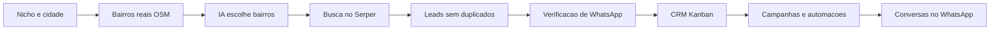

### Funcionalidades em detalhe

#### Geração de leads

A tela recebe nicho e região e acompanha o andamento da busca. Por trás, a requisição vira um job numa fila pg-boss, que roda no próprio PostgreSQL, sem Redis.

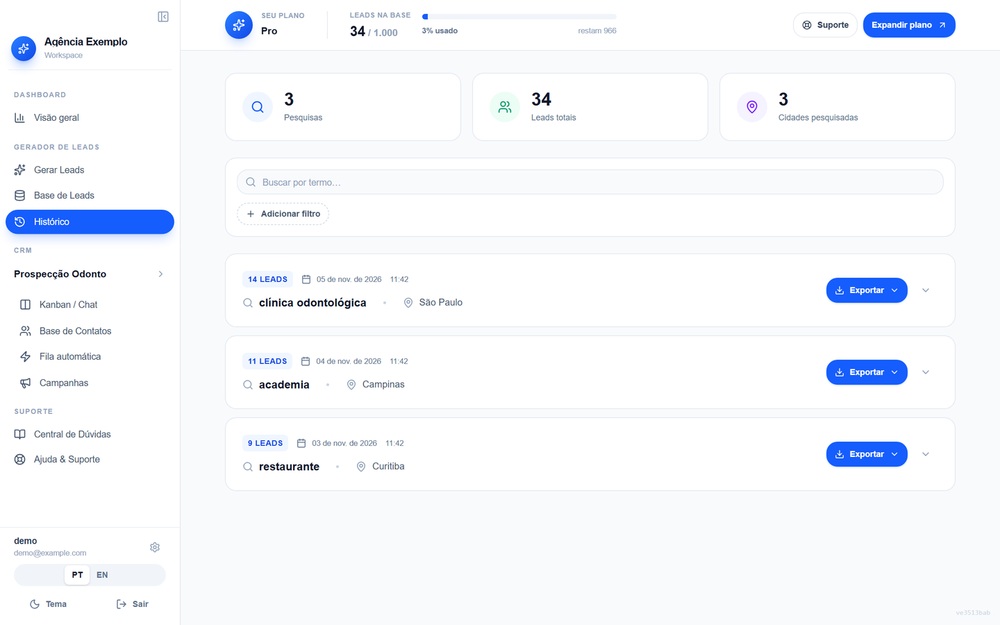 Histórico de buscas, com total de pesquisas, leads e cidades, e cada busca com exportação.

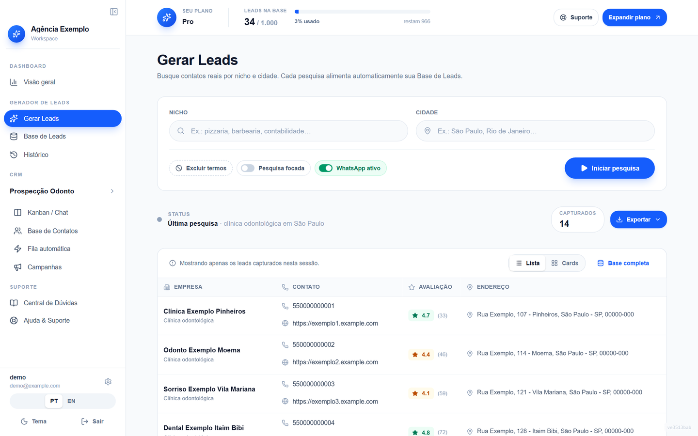 Tela Gerar Leads: nicho, cidade e opções da busca, com os leads capturados logo abaixo.

- Um índice parcial único no banco, uma checagem prévia e a chave do job impedem mais de uma busca ativa por usuário.
- A deduplicação é por estabelecimento, usando o identificador do lugar no Serper, com telefone e nome como reserva.
- Um cron recolhe buscas presas e grava um código de erro, que o front traduz para PT ou EN.
- Os tetos de leads por plano e a janela rolante de 3 horas vêm de configuração.

#### Bairros e IA

Os bairros vêm do OpenStreetMap (Nominatim e Overpass) e ficam em cache permanente por cidade. A IA, um modelo Llama 3.3 na Groq, só escolhe entre os nomes dessa lista. Qualquer nome fora dela é descartado.

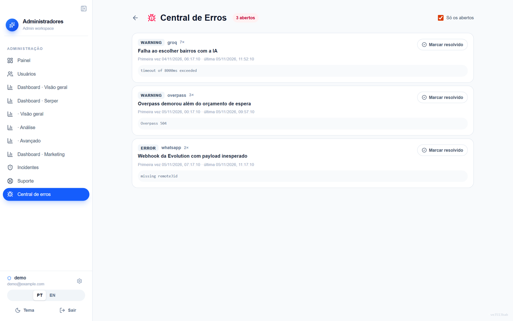 Central de Erros: falhas da IA e do Overpass chegam agrupadas, com contagem de ocorrências.

- Se o Overpass demora, a busca segue sem esperar e uma tentativa em segundo plano preenche o cache para a próxima.
- Se a Groq falha, a busca usa os bairros reais sem curadoria ou a cidade inteira.
- A falha vira um alerta no Discord, no máximo um por hora, e uma linha agrupada na Central de Erros.

#### Painel e mapa

O painel é composto por widgets com layout salvo por usuário, e o mapa usa Leaflet.

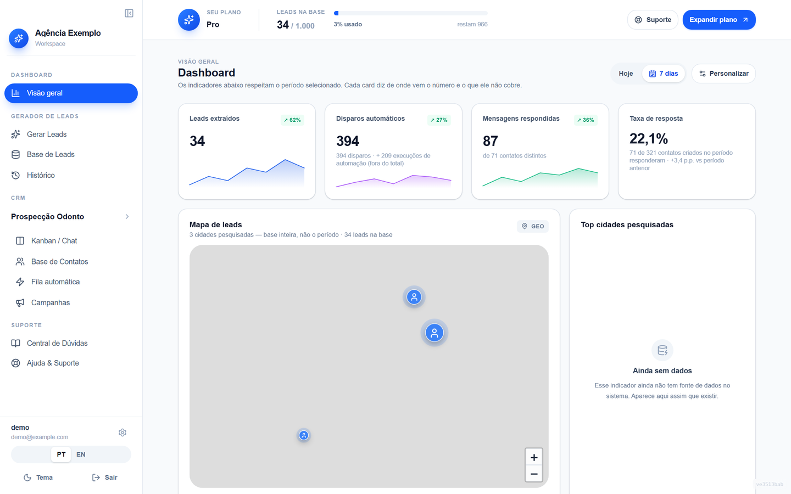 Painel com KPIs do período, sparklines e o mapa de leads por cidade pesquisada (Leaflet). Mapa exibido sem tiles de fundo.

- Um único endpoint devolve um bloco por widget, e todos os hooks compartilham essa requisição.
- O backend manda códigos, nunca frases. A tela traduz.
- Onde não há fonte de dado, o widget mostra estado indisponível em vez de um número inventado.

#### CRM Kanban

Cada usuário pode ter várias visões de CRM, cada uma com colunas, contatos, etiquetas e números de WhatsApp. O Kanban usa dnd-kit.

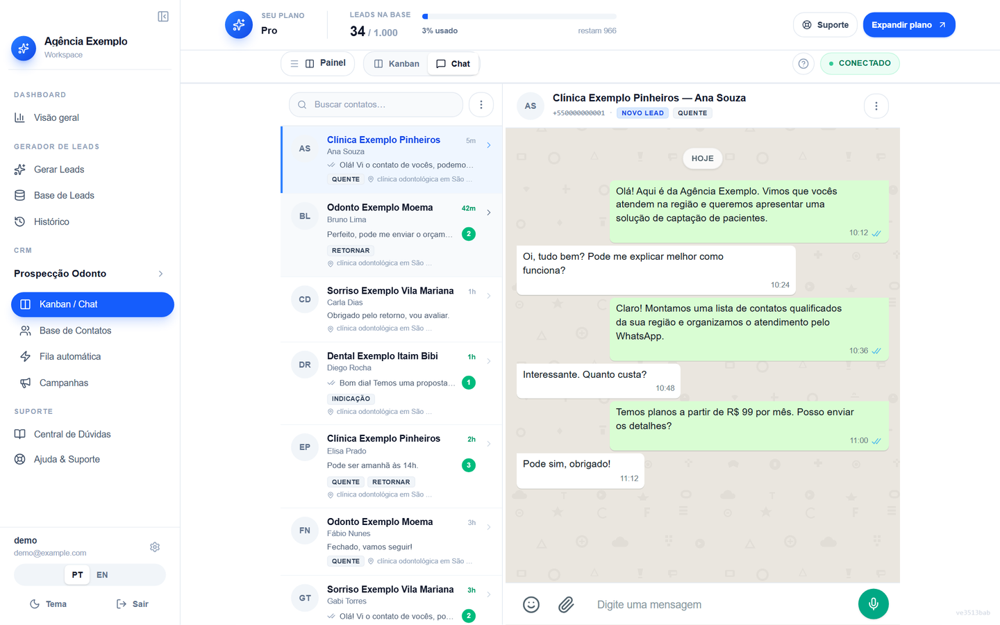 Chat integrado ao CRM: lista de conversas e janela de mensagens lado a lado.

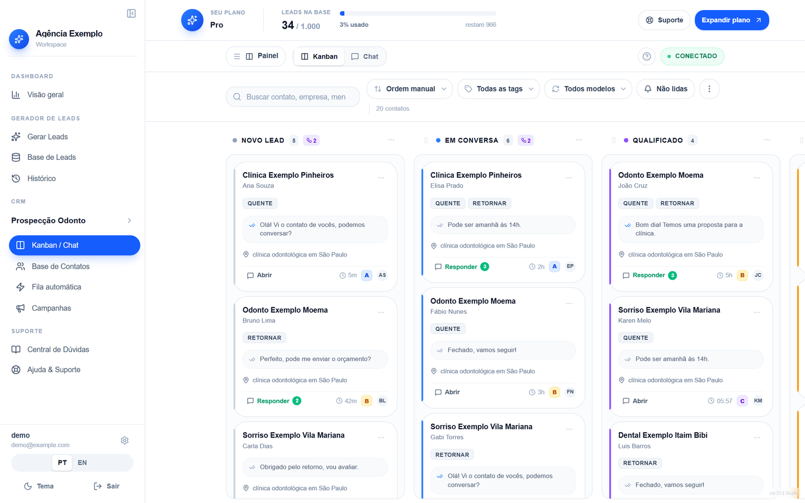 Kanban do CRM com colunas, etiquetas, modelo usado e contagem de não lidas em cada cartão.

- Entrada por importação de leads, contatos manuais e webhook.
- Chat integrado, com mídia e atualização em tempo real por SSE.
- Webhook de saída e convite por e-mail.

#### WhatsApp

Há dois canais: a Evolution API (não oficial) e a Meta Cloud API (oficial).

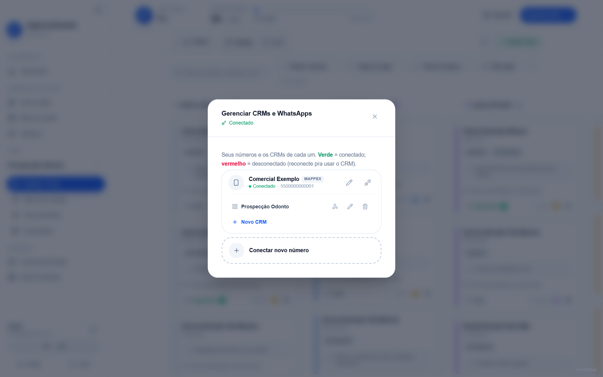 Gerenciamento de números de WhatsApp e dos CRMs ligados a cada um.

- Eventos de entrada alimentam o histórico e movem contatos.
- Palavras de descadastro encerram o envio para aquele contato.
- Telefones brasileiros são canonizados, com o nono dígito, para casar com a verificação.

#### Campanhas e envio automático

O wizard pergunta o canal logo no início, porque ele define o resto do fluxo. No canal Mappex a mensagem é texto livre com variáveis por `@`. No oficial, o texto vira um modelo aprovado pela Meta, e o `@nome` é compilado para variável posicional.

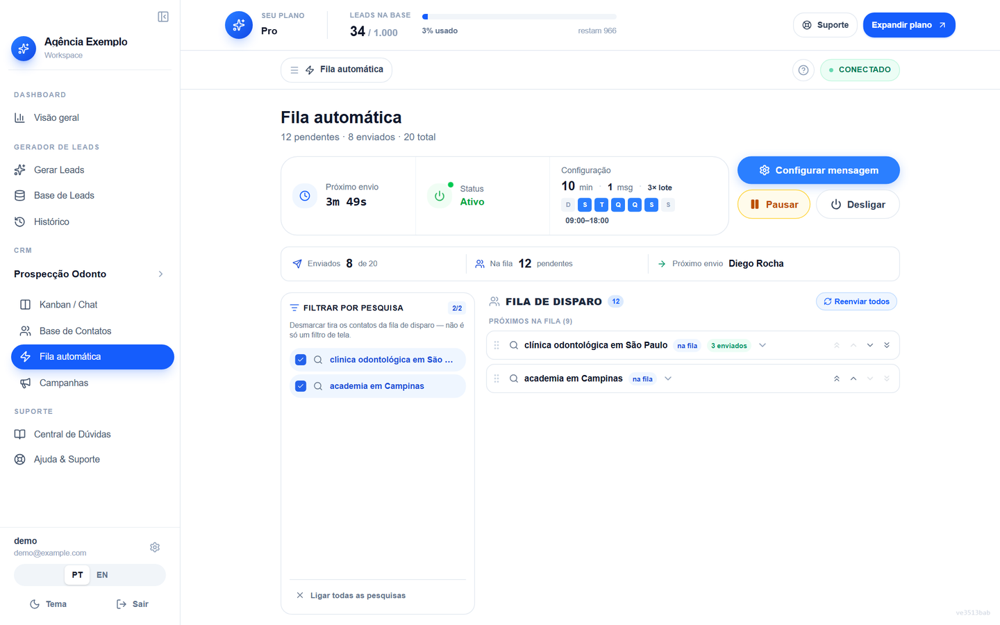 Fila automática: próximo envio, janela de horário, ritmo, fila por pesquisa e contagem de enviados.

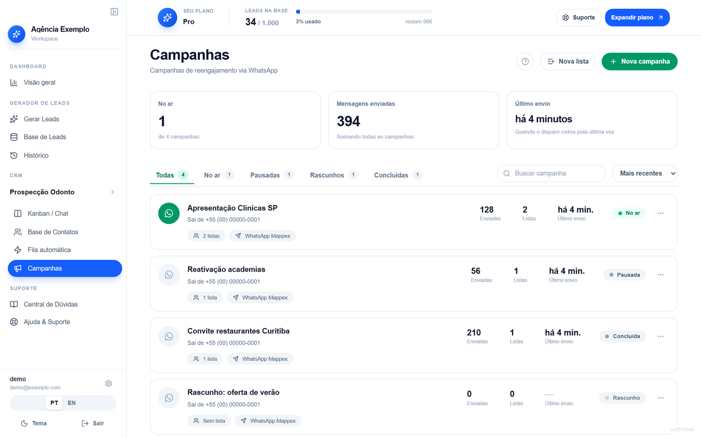 Lista de campanhas com status, envios, listas e último disparo.

- Ritmo configurável pelo usuário, com teto de 100 por hora e 1.000 por dia.
- Rodízio de 2 a 3 mensagens.
- O disparo roda no servidor, por cron, com reserva registrada antes da ação.

#### Automações

Regras por coluna, executadas no servidor, sem navegador aberto. Gatilhos: entrar na coluna, tempo parado, resposta recebida, palavra-chave e tempo sem resposta. Ações: enviar mensagem, mover ou os dois. Mover sozinho não passa pelas janelas de horário.

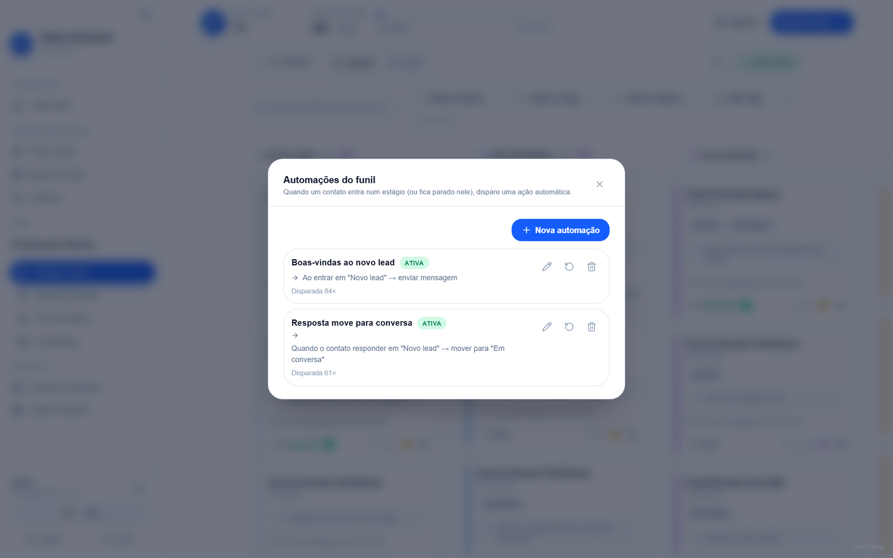 Automações do funil: regras por coluna, com gatilho, ação e quantas vezes cada uma disparou.

#### Administração

Gestão de usuários, personificação com auditoria, métricas, central de erros, mensagens de suporte, incidentes de segurança com prazo de comunicação calculado na leitura, exclusão de conta com lembrete e e-mails de remarketing por uso da cota.

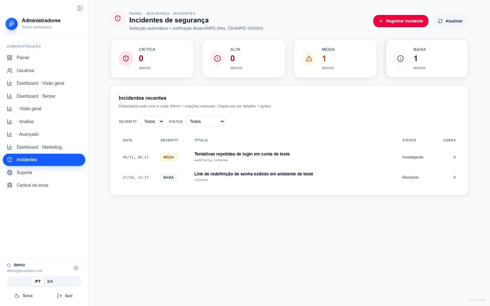 Incidentes de segurança com severidade, status e contagem por nível.

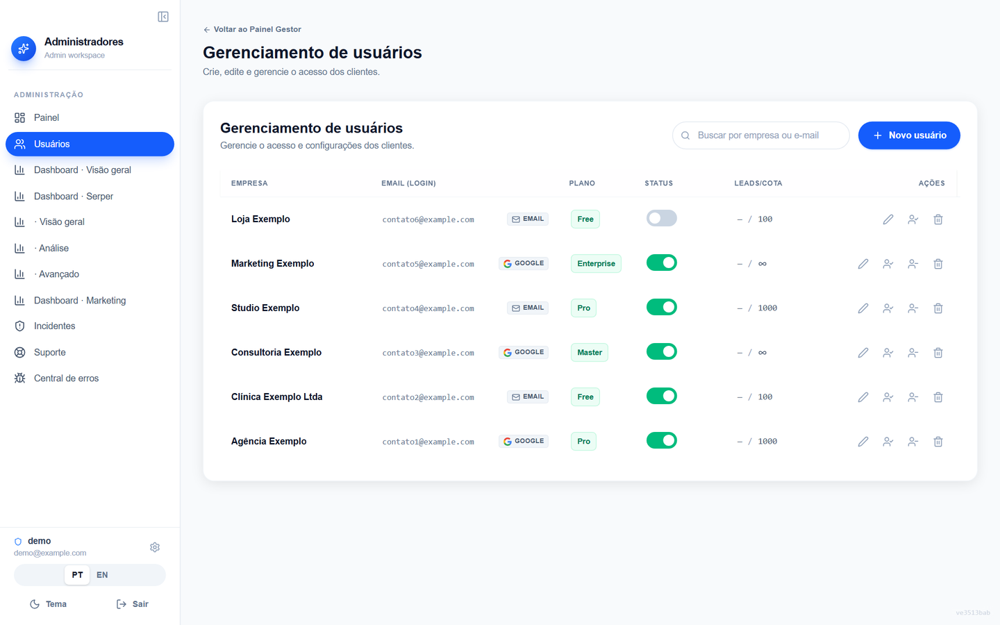 Gerenciamento de usuários: plano, status, cota de leads e ações como personificar.

### Arquitetura

O front é uma SPA React 19 com TypeScript, Vite, Tailwind e i18next (PT e EN). O backend é NestJS sobre Fastify, com Drizzle ORM e PostgreSQL. A fila e os crons rodam no mesmo processo.

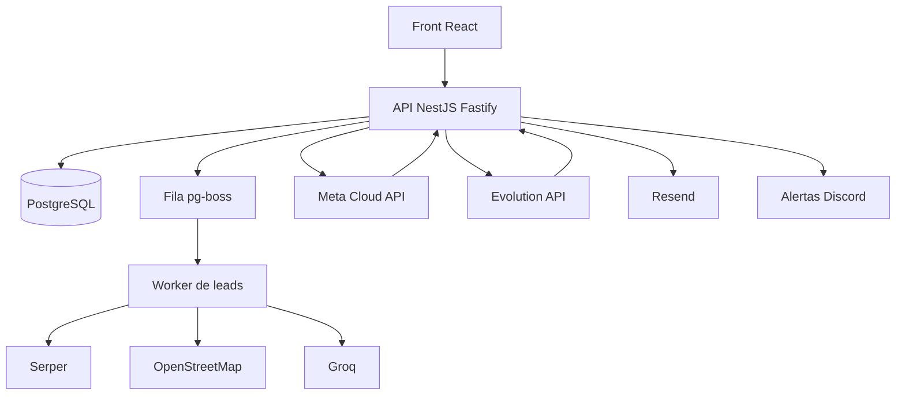

Modelo de dados, com 28 tabelas. Resumo:

- **Conta:** usuários, identidades de login (e-mail ou Google), sessões, assinaturas de plano, trilha de auditoria.
- **Leads:** buscas, leads (um por estabelecimento, ligado à busca e ao usuário), cache e consumo do Serper, bairros por cidade.
- **CRM:** visões, colunas, contatos, mensagens, etiquetas, instâncias de WhatsApp, verificações de telefone, eventos.
- **Envio:** campanhas e seus envios, envio automático, automações com log de execução.
- **Operação:** layouts do painel, métricas personalizadas, erros do sistema, incidentes de segurança, mensagens de suporte.

### Decisões de engenharia

**Reescrita de Supabase para backend próprio.** A v1 usava Supabase, com Edge Functions, RLS e os leads de cada busca guardados como um JSON. A v2 passou para NestJS, Drizzle e PostgreSQL. O legado tinha problemas documentados, como usuários sem perfil por uma corrida entre duas escritas. A tabela de leads passou a ser consultável em SQL, e a migração foi planejada com contagens reais de origem e destino antes de mexer em produção.

**IA só escolhe, não inventa.** A IA inventava bairros em cidades pequenas, e cada um custava uma chamada paga que voltava vazia. Hoje ela recebe uma lista do OpenStreetMap e o que sair dela é descartado.

**Fila no PostgreSQL.** O pg-boss evita Redis e mantém tudo no mesmo banco. Buscas parciais não são refeitas sozinhas, e um reaper libera as presas.

**Null, zero e lista vazia são coisas diferentes.** Coluna derivada ganha uma coluna que diz se a derivação rodou. Sem fonte, a tela remove o número em vez de trocar por um valor plausível.

**Efeito de React que escreve no servidor depende de valor, não de função.** Um efeito dependente de função criou instâncias órfãs de WhatsApp. O padrão passou a ser uma referência de "já executei" mais trava síncrona.

**Zero hardcode no backend.** Segredos, hosts e limites vêm de variáveis de ambiente. Env crítica ausente em produção derruba o boot; env opcional cai em padrão seguro e nunca em zero.

### Qualidade e segurança

- 3.768 testes passando em 05/11/2026: 1.566 no front e 2.202 no backend.
- Os testes de backend rodam contra pglite com as migrations reais (76 migrations aditivas e idempotentes).
- Gate de entrega: typecheck nos dois projetos, testes nos dois e build do front.
- Testes de paridade i18n entre PT e EN e de coerência entre front e backend nos tokens de mensagem.
- Texto legal travado por hash: mudar o conteúdo sem subir a versão quebra o teste.
- Rate limiting global por IP, com limites mais apertados nas rotas de autenticação.
- Senhas em argon2id, com atualização automática de hashes antigos no login. Refresh token opaco guardado só como hash. Login Google, captcha Turnstile e bloqueio de e-mail descartável.
- Personificação de admin sem refresh token.
- Trava do plano Free após 7 dias: nega por padrão qualquer escrita, e libera só o que está marcado.
- Auditoria com e-mail em hash e IP em faixa.

### Limites conhecidos

- O Overpass público é instável. Por isso há cache, orçamento de espera e tentativa em segundo plano.
- Sem a chave da Groq, o alcance da busca cai, mas ela continua funcionando.
- Migrations não rodam no boot. São aplicadas antes do deploy.
- Os modelos aprovados da Meta têm regras que a documentação não cobre, como o corpo não poder começar nem terminar com variável.

Contato: <a href="https://joaocouto.alcetus.com">joaocouto.alcetus.com</a> · <a href="mailto:joaopecouto77@gmail.com">joaopecouto77@gmail.com</a>
