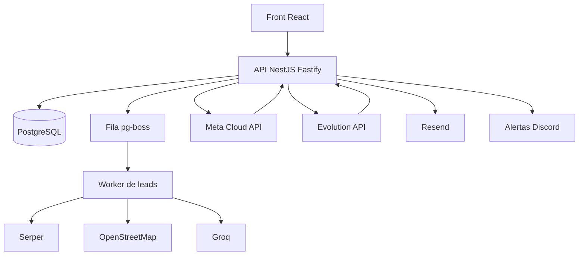
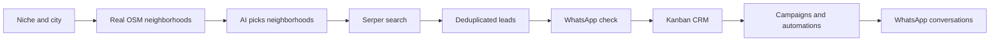
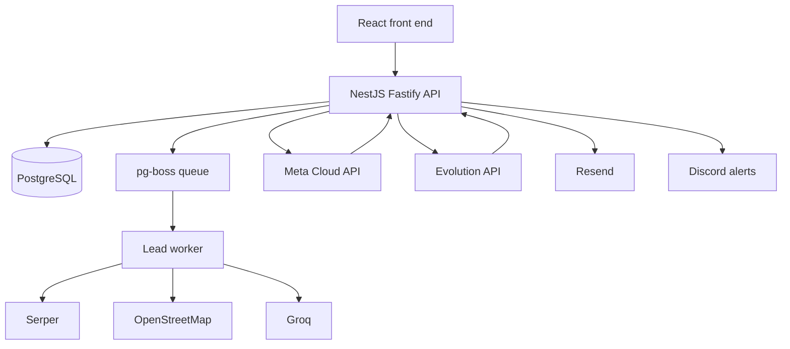

<h1 align="center">Mappex, Gerador de Leads</h1>

SaaS de geração de leads B2B com CRM no WhatsApp. <i>B2B lead-generation SaaS with a built-in WhatsApp CRM.</i>

  <kbd> React</kbd> <kbd> TypeScript</kbd> <kbd> Tailwind CSS</kbd> <kbd> Vite</kbd> <kbd> NestJS</kbd> <kbd> Fastify</kbd> <kbd> Drizzle ORM</kbd> <kbd> PostgreSQL</kbd> <kbd> Leaflet</kbd> <kbd> Docker</kbd> <kbd> Nginx</kbd> <kbd> Cloudflare</kbd>

<a href="#portugu%C3%AAs"><b>Português</b></a> &nbsp;|&nbsp; <a href="#english"><b>English</b></a>

> **PT** O código-fonte é privado; este repositório apresenta o projeto. Demo: [gerador-de-leads.alcetus.com](http://gerador-de-leads.alcetus.com).
> **EN** The source code is private; this repository presents the project. Demo: [gerador-de-leads.alcetus.com](http://gerador-de-leads.alcetus.com).

## Português

<table>
<tr>
<td align="center" width="25%"><b>28</b> tabelas no banco</td><td align="center" width="25%"><b>8+</b> integrações externas</td><td align="center" width="25%"><b>3.768</b> testes passando</td><td align="center" width="25%"><b>Supabase</b> reescrito para NestJS</td>
</tr>
</table>

### Visão geral

O Mappex é uma plataforma de geração de leads B2B com CRM e disparo de mensagens por WhatsApp. O usuário informa um nicho (por exemplo, "clínica odontológica") e uma cidade, e o sistema devolve estabelecimentos reais com telefone, endereço, nota e posição no mapa. Esses contatos entram numa base própria, passam por verificação de WhatsApp e seguem para um CRM em Kanban, onde viram conversa, campanha ou automação.

O produto é feito para quem prospecta empresas locais: agências, consultores, equipes comerciais pequenas. O problema que resolve é a distância entre achar um contato e conversar com ele. Normalmente isso passa por planilha, ferramenta de scraping, aplicativo de mensagem e controle manual do funil. Aqui tudo roda no mesmo lugar, com o mesmo cadastro e o mesmo histórico.

O código é privado. Este README descreve o que o produto faz e como foi construído.

### Como funciona

1. A pessoa entra com e-mail e senha ou com a conta Google.
2. Informa nicho e cidade e inicia a busca. Cada conta tem uma busca por vez.
3. O sistema obtém os bairros reais da cidade no OpenStreetMap e pede à IA que escolha os mais comerciais para aquele nicho.
4. Cada bairro vira uma consulta ao Serper, que devolve estabelecimentos do Google Maps. Leads repetidos são descartados.
5. Os leads aparecem no painel e no mapa. Em segundo plano, o telefone é normalizado, a UF é extraída do endereço e o número é checado quanto à existência de WhatsApp.
6. O usuário envia os leads para um CRM, conecta um número de WhatsApp e acompanha as conversas no Kanban.
7. Campanhas e automações cuidam do envio em escala, dentro de janelas de horário e tetos por hora e por dia.

### Funcionalidades em detalhe

#### Geração de leads

A tela recebe nicho e região e acompanha o andamento da busca. Por trás, a requisição vira um job numa fila pg-boss, que roda no próprio PostgreSQL, sem Redis.

- Um índice parcial único no banco, uma checagem prévia e a chave do job impedem mais de uma busca ativa por usuário.
- A deduplicação é por estabelecimento, usando o identificador do lugar no Serper, com telefone e nome como reserva.
- Um cron recolhe buscas presas e grava um código de erro, que o front traduz para PT ou EN.
- Os tetos de leads por plano e a janela rolante de 3 horas vêm de configuração.

#### Bairros e IA

Os bairros vêm do OpenStreetMap (Nominatim e Overpass) e ficam em cache permanente por cidade. A IA, um modelo Llama 3.3 na Groq, só escolhe entre os nomes dessa lista. Qualquer nome fora dela é descartado.

- Se o Overpass demora, a busca segue sem esperar e uma tentativa em segundo plano preenche o cache para a próxima.
- Se a Groq falha, a busca usa os bairros reais sem curadoria ou a cidade inteira.
- A falha vira um alerta no Discord, no máximo um por hora, e uma linha agrupada na Central de Erros.

#### Painel e mapa

O painel é composto por widgets com layout salvo por usuário, e o mapa usa Leaflet.

- Um único endpoint devolve um bloco por widget, e todos os hooks compartilham essa requisição.
- O backend manda códigos, nunca frases. A tela traduz.
- Onde não há fonte de dado, o widget mostra estado indisponível em vez de um número inventado.

#### CRM Kanban

Cada usuário pode ter várias visões de CRM, cada uma com colunas, contatos, etiquetas e números de WhatsApp. O Kanban usa dnd-kit.

- Entrada por importação de leads, contatos manuais e webhook.
- Chat integrado, com mídia e atualização em tempo real por SSE.
- Webhook de saída e convite por e-mail.

#### WhatsApp

Há dois canais: a Evolution API (não oficial) e a Meta Cloud API (oficial).

- Eventos de entrada alimentam o histórico e movem contatos.
- Palavras de descadastro encerram o envio para aquele contato.
- Telefones brasileiros são canonizados, com o nono dígito, para casar com a verificação.

#### Campanhas e envio automático

O wizard pergunta o canal logo no início, porque ele define o resto do fluxo. No canal Mappex a mensagem é texto livre com variáveis por `@`. No oficial, o texto vira um modelo aprovado pela Meta, e o `@nome` é compilado para variável posicional.

- Ritmo configurável pelo usuário, com teto de 100 por hora e 1.000 por dia.
- Rodízio de 2 a 3 mensagens.
- O disparo roda no servidor, por cron, com reserva registrada antes da ação.

#### Automações

Regras por coluna, executadas no servidor, sem navegador aberto. Gatilhos: entrar na coluna, tempo parado, resposta recebida, palavra-chave e tempo sem resposta. Ações: enviar mensagem, mover ou os dois. Mover sozinho não passa pelas janelas de horário.

#### Administração

Gestão de usuários, personificação com auditoria, métricas, central de erros, mensagens de suporte, incidentes de segurança com prazo de comunicação calculado na leitura, exclusão de conta com lembrete e e-mails de remarketing por uso da cota.

### Arquitetura

O front é uma SPA React 19 com TypeScript, Vite, Tailwind e i18next (PT e EN). O backend é NestJS sobre Fastify, com Drizzle ORM e PostgreSQL. A fila e os crons rodam no mesmo processo.

Modelo de dados, com 28 tabelas. Resumo:

- **Conta:** usuários, identidades de login (e-mail ou Google), sessões, assinaturas de plano, trilha de auditoria.
- **Leads:** buscas, leads (um por estabelecimento, ligado à busca e ao usuário), cache e consumo do Serper, bairros por cidade.
- **CRM:** visões, colunas, contatos, mensagens, etiquetas, instâncias de WhatsApp, verificações de telefone, eventos.
- **Envio:** campanhas e seus envios, envio automático, automações com log de execução.
- **Operação:** layouts do painel, métricas personalizadas, erros do sistema, incidentes de segurança, mensagens de suporte.

### Decisões de engenharia

**Reescrita de Supabase para backend próprio.** A v1 usava Supabase, com Edge Functions, RLS e os leads de cada busca guardados como um JSON. A v2 passou para NestJS, Drizzle e PostgreSQL. O legado tinha problemas documentados, como usuários sem perfil por uma corrida entre duas escritas. A tabela de leads passou a ser consultável em SQL, e a migração foi planejada com contagens reais de origem e destino antes de mexer em produção.

**IA só escolhe, não inventa.** A IA inventava bairros em cidades pequenas, e cada um custava uma chamada paga que voltava vazia. Hoje ela recebe uma lista do OpenStreetMap e o que sair dela é descartado.

**Fila no PostgreSQL.** O pg-boss evita Redis e mantém tudo no mesmo banco. Buscas parciais não são refeitas sozinhas, e um reaper libera as presas.

**Null, zero e lista vazia são coisas diferentes.** Coluna derivada ganha uma coluna que diz se a derivação rodou. Sem fonte, a tela remove o número em vez de trocar por um valor plausível.

**Efeito de React que escreve no servidor depende de valor, não de função.** Um efeito dependente de função criou instâncias órfãs de WhatsApp. O padrão passou a ser uma referência de "já executei" mais trava síncrona.

**Zero hardcode no backend.** Segredos, hosts e limites vêm de variáveis de ambiente. Env crítica ausente em produção derruba o boot; env opcional cai em padrão seguro e nunca em zero.

### Qualidade e segurança

- 3.768 testes passando em 05/11/2026: 1.566 no front e 2.202 no backend.
- Os testes de backend rodam contra pglite com as migrations reais (76 migrations aditivas e idempotentes).
- Gate de entrega: typecheck nos dois projetos, testes nos dois e build do front.
- Testes de paridade i18n entre PT e EN e de coerência entre front e backend nos tokens de mensagem.
- Texto legal travado por hash: mudar o conteúdo sem subir a versão quebra o teste.
- Rate limiting global por IP, com limites mais apertados nas rotas de autenticação.
- Senhas em argon2id, com atualização automática de hashes antigos no login. Refresh token opaco guardado só como hash. Login Google, captcha Turnstile e bloqueio de e-mail descartável.
- Personificação de admin sem refresh token.
- Trava do plano Free após 7 dias: nega por padrão qualquer escrita, e libera só o que está marcado.
- Auditoria com e-mail em hash e IP em faixa.

### Limites conhecidos

- O Overpass público é instável. Por isso há cache, orçamento de espera e tentativa em segundo plano.
- Sem a chave da Groq, o alcance da busca cai, mas ela continua funcionando.
- Migrations não rodam no boot. São aplicadas antes do deploy.
- Os modelos aprovados da Meta têm regras que a documentação não cobre, como o corpo não poder começar nem terminar com variável.

## English

<table>
<tr>
<td align="center" width="25%"><b>28</b> database tables</td><td align="center" width="25%"><b>8+</b> external integrations</td><td align="center" width="25%"><b>3,768</b> passing tests</td><td align="center" width="25%"><b>Supabase</b> rewritten for NestJS</td>
</tr>
</table>

### Overview

Mappex is a B2B lead generation platform with a built-in CRM and WhatsApp messaging. The user types a niche (for example "dental clinic") and a city, and the system returns real businesses with phone, address, rating and map position. Those contacts go into the user's own database, get checked for WhatsApp, and move on to a Kanban CRM where they become conversations, campaigns or automations.

It is built for people who prospect local businesses: agencies, consultants, small sales teams. The problem it solves is the gap between finding a contact and talking to them. That usually means a spreadsheet, a scraping tool, a chat app and a manually kept funnel. Here it all runs in one place, with one record and one history.

The code is private. This README describes what the product does and how it was built.

### How it works

1. The user signs in with email and password or a Google account.
2. They enter a niche and a city and start a search. Each account runs one search at a time.
3. The system gets the city's real neighborhoods from OpenStreetMap and asks the AI to pick the most commercial ones for that niche.
4. Each neighborhood becomes a Serper query, which returns Google Maps businesses. Repeated leads are dropped.
5. Leads show up on the dashboard and map. In the background, phones are normalized, the state is extracted from the address and the number is checked for WhatsApp.
6. The user sends leads to a CRM, connects a WhatsApp number and follows conversations on the Kanban board.
7. Campaigns and automations handle sending at scale, inside time windows and hourly and daily caps.

### Features in detail

#### Lead generation

The screen takes a niche and region and follows the search progress. Behind it, the request becomes a job in a pg-boss queue, which runs inside PostgreSQL itself, with no Redis.

- A partial unique index in the database, a pre-check and the job key keep each user to one active search.
- Deduplication is per business, using the Serper place identifier, with phone and name as fallbacks.
- A cron collects stuck searches and records an error code, which the front end translates to PT or EN.
- Per-plan lead caps and a rolling 3-hour window come from configuration.

#### Neighborhoods and AI

Neighborhoods come from OpenStreetMap (Nominatim and Overpass) and are cached permanently per city. The AI, a Llama 3.3 model on Groq, only chooses from that list. Any name outside it is discarded.

- If Overpass is slow, the search moves on without waiting and a background attempt fills the cache for the next one.
- If Groq fails, the search uses the real neighborhoods without curation, or the whole city.
- The failure becomes a Discord alert, at most one per hour, plus a grouped row in the error center.

#### Dashboard and map

The dashboard is made of widgets with a per-user saved layout, and the map uses Leaflet.

- One endpoint returns one block per widget, and all hooks share that request.
- The backend sends codes, never sentences. The UI translates.
- Where there is no data source, the widget shows an unavailable state instead of an invented number.

#### Kanban CRM

Each user can have several CRM views, each with its own columns, contacts, tags and WhatsApp numbers. The Kanban uses dnd-kit.

- Contacts come from lead import, manual entry and webhook.
- Built-in chat with media and real-time updates over SSE.
- Outgoing webhook and email invites.

#### WhatsApp

There are two channels: Evolution API (unofficial) and Meta Cloud API (official).

- Inbound events feed the history and move contacts.
- Opt-out keywords stop sending to that contact.
- Brazilian phone numbers are canonicalized, including the ninth digit, to match the verification.

#### Campaigns and auto-send

The wizard asks for the channel up front, because it decides the rest of the flow. On the Mappex channel the message is free text with `@` variables. On the official channel the text becomes a Meta-approved template, and `@name` is compiled to a positional variable.

- Pace set by the user, capped at 100 per hour and 1,000 per day.
- Rotation of 2 to 3 messages.
- Sending runs on the server, by cron, with a claim recorded before each action.

#### Automations

Per-column rules, run on the server with no browser open. Triggers: enter a column, time in column, reply received, keyword and time without reply. Actions: send a message, move, or both. A plain move skips the time windows.

#### Administration

User management, audited impersonation, metrics, an error center, support messages, security incidents with a notification deadline computed at read time, account deletion with a reminder, and remarketing emails based on quota usage.

### Architecture

The front end is a React 19 SPA with TypeScript, Vite, Tailwind and i18next (PT and EN). The backend is NestJS on Fastify, with Drizzle ORM and PostgreSQL. The queue and the crons run in the same process.

Data model, 28 tables. Summary:

- **Account:** users, login identities (email or Google), sessions, plan subscriptions, audit trail.
- **Leads:** searches, leads (one per business, tied to the search and the user), Serper cache and usage, neighborhoods per city.
- **CRM:** views, columns, contacts, messages, tags, WhatsApp instances, phone verifications, events.
- **Sending:** campaigns and their sends, auto-send, automations with an execution log.
- **Operations:** dashboard layouts, custom metrics, system errors, security incidents, support messages.

### Engineering decisions

**Rewriting from Supabase to an own backend.** Version 1 used Supabase, with Edge Functions, RLS and each search's leads stored as one JSON blob. Version 2 moved to NestJS, Drizzle and PostgreSQL. The legacy system had documented issues, such as users without a profile from a race between two writes. The leads table became queryable in SQL, and the migration was planned against real source and target counts before touching production.

**AI chooses, it does not invent.** The AI used to make up neighborhoods in small cities, and each one cost a paid call that came back empty. Now it receives an OpenStreetMap list, and anything outside it is discarded.

**Queue in PostgreSQL.** pg-boss avoids Redis and keeps everything in one database. Partial searches are not retried automatically, and a reaper frees the stuck ones.

**Null, zero and empty list are different things.** A derived column gets a companion column saying whether the derivation ran. With no source, the UI removes the number instead of swapping in a plausible one.

**A React effect that writes to the server depends on a value, not a function.** An effect depending on a function created orphan WhatsApp instances. The pattern became an "already ran" ref plus a synchronous lock.

**Zero hardcoding in the backend.** Secrets, hosts and limits come from environment variables. A missing critical env in production stops the boot; an optional one falls back to a safe default and never to zero.

### Quality and security

- 3,768 tests passing on 2026-11-05: 1,566 front end and 2,202 backend.
- Backend tests run against pglite with the real migrations (76 additive, idempotent migrations).
- Delivery gate: typecheck on both projects, tests on both, and the front-end build.
- Parity tests for PT and EN i18n, and a front-to-backend consistency test for message tokens.
- Legal text is locked by hash: changing the content without bumping the version breaks the test.
- Global per-IP rate limiting, with tighter limits on authentication routes.
- Passwords use argon2id, with automatic upgrade of old hashes on login. Opaque refresh tokens stored only as a hash. Google login, Turnstile captcha and disposable email blocking.
- Admin impersonation has no refresh token.
- The Free plan lock after 7 days denies any write by default and allows only what is marked.
- Audit trail with hashed email and IP truncated to a range.

### Known limits

- The public Overpass service is unstable. Hence the cache, the wait budget and the background retry.
- Without the Groq key, search reach drops, but it keeps working.
- Migrations do not run at boot. They are applied before deploy.
- Meta-approved templates have rules the documentation does not cover, such as the body not being allowed to start or end with a variable.

Contato · Contact: <a href="https://joaocouto.alcetus.com">joaocouto.alcetus.com</a> · <a href="mailto:joaopecouto77@gmail.com">joaopecouto77@gmail.com</a>
