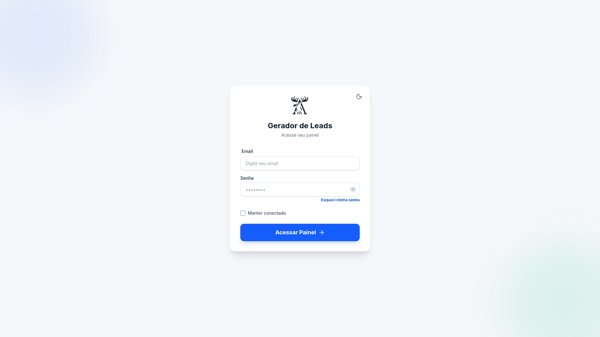

<h1 align="center">Mappex, Gerador de Leads</h1>

SaaS de geração de leads B2B com CRM no WhatsApp. <i>B2B lead-generation SaaS with a built-in WhatsApp CRM.</i>

  <kbd> React</kbd> <kbd> TypeScript</kbd> <kbd> Tailwind CSS</kbd> <kbd> Vite</kbd> <kbd> NestJS</kbd> <kbd> Fastify</kbd> <kbd> Drizzle ORM</kbd> <kbd> PostgreSQL</kbd> <kbd> Docker</kbd> <kbd> Nginx</kbd> <kbd> Cloudflare</kbd>

> **PT** O código-fonte é privado; este repositório apresenta o projeto. Demo: [gerador-de-leads.alcetus.com](http://gerador-de-leads.alcetus.com).
> **EN** The source code is private; this repository presents the project. Demo: [gerador-de-leads.alcetus.com](http://gerador-de-leads.alcetus.com).

## Português

### O problema

Pequenas empresas perdem horas procurando clientes à mão e gerenciando conversas espalhadas no WhatsApp, sem processo nem acompanhamento.

### A solução

Plataforma que encontra empresas por região, dispara campanhas e centraliza o relacionamento num CRM com WhatsApp, do primeiro contato ao fechamento.

### Funcionalidades

- **Geração de leads** por nicho e região via Serper, com **bairros reais do OpenStreetMap**: o modelo de IA (Llama 3.3, via Groq) só escolhe entre eles e nunca cria bairro. Falha da IA vira alerta no Discord.
- **CRM com pipeline Kanban** (drag-and-drop com dnd-kit) e chat em tempo real pelo WhatsApp (Meta Cloud API e Evolution API).
- **Automações por gatilho** (sem resposta em X horas, palavra-chave e outros) montadas num editor visual de fluxos (@xyflow/react).
- **Dashboard** com mapa interativo (Leaflet) e gráficos de indicadores; campanhas de e-mail (Resend) e fluxos de remarketing.
- Autenticação JWT e Google OAuth, rate limiting e detecção de incidentes de segurança.

### Stack e arquitetura

- **Front-end:** React 19, TypeScript, Vite, Tailwind CSS, i18next.
- **Back-end:** NestJS com Fastify, Drizzle ORM, PostgreSQL e filas com pg-boss.
- **Evolução de arquitetura:** a v1 nasceu em Supabase e Edge Functions (Deno) e foi reescrita para um backend próprio em NestJS.
- **Infra:** Docker, Nginx, VPS e Cloudflare.
- **Escala:** 28 tabelas no banco e mais de 8 integrações externas.

### Qualidade

**3.768 testes automatizados** passando em 05/11/2026 (1.566 no frontend e 2.202 no backend), incluindo testes de integração com banco em memória.

## English

### The problem

Small businesses waste hours prospecting by hand and juggling scattered WhatsApp chats with no process or follow-up.

### The solution

A platform that finds companies by region, runs campaigns and centralizes the relationship in a WhatsApp CRM, from first contact to close.

### Features

- **Lead generation** by niche and region through Serper, using **real OpenStreetMap neighborhoods**: the AI model (Llama 3.3 via Groq) only picks among them and never invents one. An AI failure raises a Discord alert.
- **Kanban pipeline CRM** (drag and drop with dnd-kit) and real-time WhatsApp chat (Meta Cloud API and Evolution API).
- **Trigger-based automations** (no reply in X hours, keywords and more) built in a visual flow editor (@xyflow/react).
- **Dashboard** with an interactive map (Leaflet) and indicator charts; email campaigns (Resend) and remarketing flows.
- JWT and Google OAuth authentication, rate limiting and security-incident detection.

### Stack and architecture

- **Front-end:** React 19, TypeScript, Vite, Tailwind CSS, i18next.
- **Back-end:** NestJS on Fastify, Drizzle ORM, PostgreSQL and pg-boss queues.
- **Architecture evolution:** v1 started on Supabase and Edge Functions (Deno) and was rewritten into a dedicated NestJS backend.
- **Infra:** Docker, Nginx, VPS and Cloudflare.
- **Scale:** 28 database tables and 8+ external integrations.

### Quality

**3,768 automated tests** passing on 2026-11-05 (1,566 frontend and 2,202 backend), including integration tests against an in-memory database.

Contato · Contact: <a href="https://joaocouto.alcetus.com">joaocouto.alcetus.com</a> · <a href="mailto:joaopecouto77@gmail.com">joaopecouto77@gmail.com</a>
